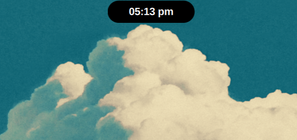
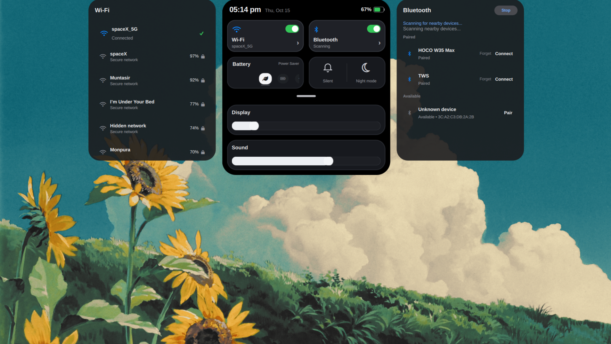
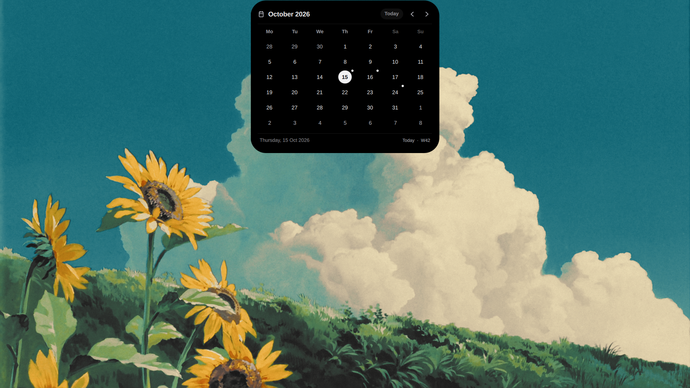
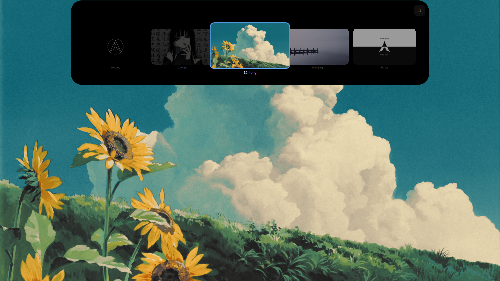
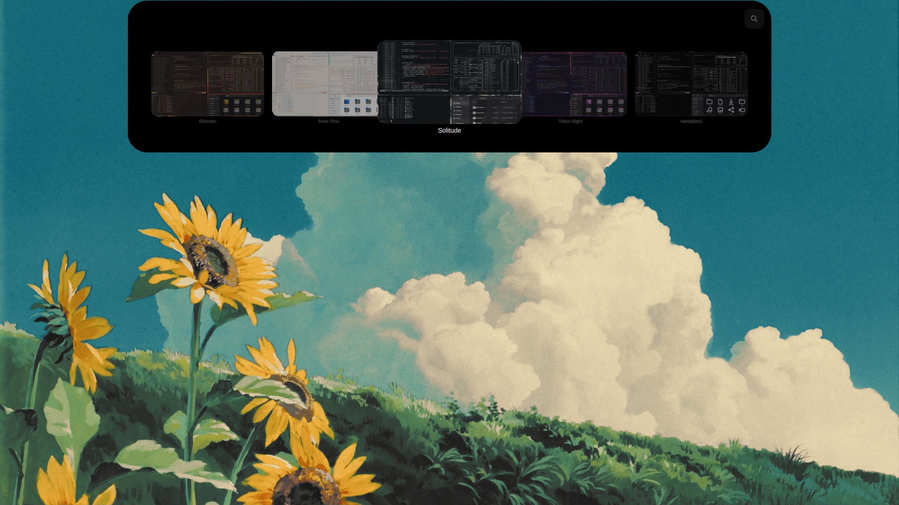

<div align="center">

# 🌊 Omarchy Tide Island

**Swap the Omarchy bar for a Dynamic-Island-style overlay, one keypress at a time.**

[Tide Island](https://github.com/enhaoswen/Tide-island) and the Omarchy bar never show together, and when the island is up it cleanly owns the screen.




</div>

---

## ✨ Features

- **One toggle:** `SUPER + SHIFT + SPACE` flips the top bar **and** Tide Island together. The island runs while the bar is hidden and stops when the bar returns.
- **No double UI:** while the bar is hidden, the built-in OSD and notification popups stand down, because Tide Island draws its own volume/brightness control center and notification stack. Notification history still works (the newest 10 are kept) and DND is unaffected.
- **Self-healing:** state is reconciled at shell start, on every flag change and after rapid toggles, so a session restart can never leave the bar and island both visible (or both hidden).
- **Zero-setup install:** add the plugin and it configures everything itself. Tide Island is bundled, so there is no AUR/package step and no sudo.
- **Omarchy-aware wallpaper & theme pickers:** browse the current theme's backgrounds and themes from the island, applied via Omarchy's own commands so everything stays in sync.
- **Clean removal:** `omarchy plugin remove` reverses the setup and preserves your config and edits.

## 📸 Screenshots

| Control center | Calendar |
| :---: | :---: |
|  |  |
| Wi-Fi, Bluetooth, battery mode, display and sound, with Wi-Fi/Bluetooth panels expanding on each side. | Month view with today highlighted and the week number. |

| Wallpaper picker | Theme picker |
| :---: | :---: |
|  |  |
| `SUPER + ALT + W`: browse the current theme's wallpapers. | `SUPER + ALT + Q`: switch Omarchy themes with live previews. |

## 🚀 Quick start

Prerequisites: `quickshell`, `jq`, `patch`, `diff3` (all present on a stock Omarchy).

```sh
omarchy plugin add https://github.com/MrUranium1/Omarchy-Tide-Island --enable
```

That's it. On first load the plugin sets itself up and the island appears whenever the bar is hidden. Press `SUPER + SHIFT + SPACE` to try it.

<details>
<summary><b>What the automatic setup does</b></summary>

- Installs the bundled Tide Island into `~/.local/share/omarchy-tide-island` (no sudo) and links `~/.local/bin/tide-island`
- Installs the user `tide-island.service` and the CLI shims
- Seeds the config files (never overwrites existing ones)
- Creates and patches the OSD/notification clones
- Wires the keybindings into `hyprland.lua`
- Installs the **Tide Island Settings** app (open it from the app menu, or run `tide-island-config-app`)

</details>

## ⌨️ Shortcuts

`SUPER + SHIFT + SPACE` toggles the bar and island together.

The island's own shortcuts live in the `SUPER + ALT +` namespace so they never shadow Omarchy's bindings (Omarchy reserves `SUPER + ALT +` F, G, K and S).

| Shortcut | Action |
| --- | --- |
| `SUPER + ALT + I` | Toggle island |
| `SUPER + ALT + H` | Previous island view |
| `SUPER + ALT + J` | Clock view |
| `SUPER + ALT + T` | Timer |
| `SUPER + ALT + M` | Music player |
| `SUPER + ALT + C` | Control center |
| `SUPER + ALT + P` | Power menu |
| `SUPER + ALT + N` | Notification history |
| `SUPER + ALT + A` | Application launcher |
| `SUPER + ALT + O` | File shelf |
| `SUPER + ALT + V` | Clipboard manager |
| `SUPER + ALT + D` | Calendar |
| `SUPER + ALT + W` | Wallpaper library |
| `SUPER + ALT + Q` | Theme selection |

Unassigned by default: workspace overview (`overview:toggle`), next island view (`tide:swipeRight`) and weather (`tide:toggleWeather`). Assign them in the settings app if you want them.

## 🧠 How it works

```
SUPER+SHIFT+SPACE ──> omarchy-tide-island-toggle (CLI shim)
                        │  prefers IPC            falls back to scripts/
                        ▼                          ▼
                   omarchy-shell tide-island toggle
                        │
                        ▼
              ~/.local/state/omarchy/toggles/bar-off  <-- flip or create
                        │
                        ▼
        scripts/tide-sync.sh reconcile   (idempotent state machine)
        bar-off present  ->  tide-island.service start
        bar-off absent   ->  tide-island.service stop
                        │
                        ▼
   patched OSD / notifications clones watch the same flag
   and hide their overlays while it is present (see patches/)
```

Everything is a single **service** plugin (`mehir.tide-island`) that watches the flag, owns reconciliation and talks to the CLI over IPC, with no polling daemon.

## 🛠 Manual install

```sh
bash install.sh            # from a checkout
# or, from any Omarchy session:
omarchy-shell tide-island setup
```

Both paths are safe to repeat (re-run `install.sh` to repair). In order, they:

1. Install the bundled Tide Island (skipped if `tide-island` is already on your `PATH`) and the `omarchy-tide-island-toggle` / `omarchy-tide-island-status` commands into `~/.local/bin/`.
2. Seed `~/.config/omarchy/tide-island.json` (only if absent) and, only if you have no Tide config yet, `~/.config/tide-island/userconfig.json` with the [default look](#-default-island-look).
3. Clone `omarchy.osd` / `omarchy.notifications` into your config (only if you have no clones yet) and patch them to stand down while the flag is present. Built-ins are never touched, and every modified file is backed up to `~/.local/state/omarchy/tide-island/backups/`. An existing suppressed clone is detected and left as-is.
4. Wire the keybinding **only if nothing already binds `SUPER + SHIFT + SPACE`**. On a fresh machine it installs `packaging/hyprland-tide-island.lua` into `~/.config/hypr/` and adds one `require_optional` line to `hyprland.lua`.
5. Verify the patched clones actually serve (`scripts/ensure-mount.sh` bounces the mounted plugin set and re-checks). Setup is only marked complete once they report live over the shell IPC.
6. Apply the island keybindings via `scripts/wire-shortcuts.sh` into the settings app's managed block. It is idempotent and non-destructive; skip it with `install.sh --no-shortcuts`.
7. Reconcile Tide Island against the current bar state.

> **Note:** you'll see Omarchy's standard "Editing Cloned Plugin" toast during setup. That is Omarchy confirming it created a clone, not an error. The install follows it with an explainer notification.

State is recorded under `~/.local/state/omarchy/tide-island/`. Existing desktop entries are never overwritten, and entries the plugin created are removed only while they still match the recorded copy.

## ⚙️ Configuration

`~/.config/omarchy/tide-island.json` (defaults shown; include only the keys you want to change):

```json
{
  "coordinateWithBar": true,
  "startWithBarHidden": true,
  "stopWithBarShown": true,
  "suppressOsd": true,
  "suppressNotifications": true,
  "serviceName": "tide-island.service",
  "togglesDir": "~/.local/state/omarchy/toggles",
  "barOffFile": "bar-off"
}
```

| Key | Effect |
| --- | --- |
| `coordinateWithBar` | Master switch: tie the tide service to the bar flag. |
| `startWithBarHidden` | Start the tide service when the bar is hidden. |
| `stopWithBarShown` | Stop (and take down) the tide service when the bar shows. |
| `suppressOsd` | OSD overlay stands down while the flag is present. |
| `suppressNotifications` | Notification popups stand down; history still records. |
| `serviceName` | systemd unit to start/stop. |
| `togglesDir` / `barOffFile` | Where the bar-off flag lives. |

### 🎨 Default island look

On first install, and only if you have no Tide config, `~/.config/tide-island/userconfig.json` is seeded with:

```json
{
  "islandExclusiveZone": 9,
  "islandTopMargin": 1,
  "islandBackgroundOpacity": 100,
  "islandHeight": 36,
  "islandWidth": 140
}
```

That's Reserved Top Space 9, Top Margin 1, fully opaque, 36 px tall and 140 px wide. It's a one-time seed; change or remove it freely, and the settings app reflects it.

### Optional: swipe-lyrics without album art

A personal, opt-in tweak to Tide Island that removes the cover thumbnail in the swipe-lyrics view. It is never applied automatically:

```sh
scripts/patch-tide-lyrics.sh              # apply
scripts/patch-tide-lyrics.sh --restore    # undo
```

## 🧹 Removal

**Option 1: `omarchy plugin remove mehir.tide-island`.** The plugin notices its directory is gone and runs the self-contained teardown at `~/.local/lib/omarchy-tide-island/teardown.sh`. It:

- restores OSD/notification behavior by reversing only its own patch hunks
- removes unchanged plugin-owned shims, PATH links, desktop entries and runtime files
- removes the exact Hyprland require line and shortcut block it recorded
- **keeps** your configuration, clone edits, modified desktop entries and recovery backups (clones are kept on automatic removal)

**Option 2: `bash uninstall.sh --remove-plugin --remove-runtime`** from a checkout. It also requests removal of clones the plugin created, but deletes one only if its files still match the installation snapshot. Modified clones stay, and conflicts are logged with the path and backup location for manual merge. A stand-down you had *before* this plugin is left untouched.

Preserved by default: `~/.config/omarchy/tide-island.json`, `~/.config/tide-island/userconfig.json` and teardown backups. To delete only the plugin config, run `bash uninstall.sh --purge-config` and type `PURGE` when prompted. The Tide userconfig is never purged. `--final` won't delete state that still holds backups or pending suppression markers.

Desktop entries and the bundled runtime are tracked by content fingerprint: anything you edited is preserved and its path logged, and an unverified legacy runtime is preserved too.

## 🔒 What this never touches

- `~/.config/tide-island/userconfig.json`, apart from the one-time seed when you have no Tide config
- Your Tide QML override or `~/.local/share/tide-island/` (the bundled runtime lives in a separate prefix, `~/.local/share/omarchy-tide-island`)
- The built-in `omarchy.osd` / `omarchy.notifications` plugins (only your own clones are patched)
- Your Hyprland bindings, when a bar/tide binding already exists

## 📋 Compatibility

- The stand-down patches Omarchy's first-party `omarchy.osd` / `omarchy.notifications`, so it is **version sensitive**. If Omarchy changes those plugins, `scripts/ensure-suppression.sh` may need updating. `tests/unit.sh` checks the patches apply and reverse cleanly.
- Immediate serving of the patched clones relies on Omarchy's shell IPC (`omarchy-shell <target> syncSuppression` and `shell rescanPlugins`). If that changes, `scripts/ensure-mount.sh` fails safe: it logs why, writes no "setup complete" marker, and retries on the next shell start.
- Verified against the first-party OSD/notifications of the Omarchy version current at the time of writing.

## 🧪 Tests

```sh
bash tests/unit.sh         # offline: sync state machine, config parity, patch applicability
bash tests/cliphist.sh     # offline: clipboard image cache privacy (cliphist-helper.sh)
bash tests/config-perms.sh # offline: settings config permissions (0700/0600, hardened launcher)
bash tests/smoke.sh        # repo self-check, incl. shell schema validation and shortcut collisions
bash tests/cleanroom.sh    # full install -> upgrade -> uninstall -> reinstall in a throwaway $HOME
bash tests/live.sh         # needs a live Omarchy session; toggles bar/Tide and verifies
```

`cleanroom.sh` fakes `omarchy`, `omarchy-shell` and `systemctl` inside a disposable `$HOME`, so it's safe to run on a real machine.

## 📄 Licensing

- Plugin orchestration code and the Omarchy bridge: **MIT** (`LICENSE`)
- Omarchy suppression patches: modify Omarchy's MIT-licensed plugins
- Bundled Tide Island runtime, Tide-derived theme-picker QML and the optional lyrics patch: **GPL-3.0-only** (`LICENSES/GPL-3.0-only.txt`)
- Quickshell: separate LGPL-3.0-only runtime dependency

See `NOTICE.md` and `vendor/tide-island/PROVENANCE.md` for exact scope and source provenance. The manifest's `license` string summarizes these and does not claim all files share one license.

## 🙏 Credits

Built on [Tide Island](https://github.com/enhaoswen/Tide-island) by enhaoswen, for [Omarchy](https://omarchy.org).
